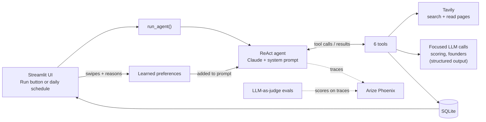

# Scout architecture

Scout is a single-agent system that sources very early-stage companies for a VC fund. A fund
enters its thesis; the agent searches the web, researches companies and founders, scores each
one against the thesis, and saves the good ones for the fund to review. The fund's reviews
feed back into the next run, every step is traced, and LLM-as-judge evals check the output.

**In one sentence:** the model decides *what to do next*; code decides *what is allowed*.

---

## 1. The system at a glance

## 2. One run, step by step

1. **Start.** `run_agent()` (scout/agent.py) loads the fund profile and learned preferences,
   records a run, and builds the agent.
2. **Reason.** Claude reads its system prompt and the request ("find 3 new companies") and
   decides which tool to call.
3. **Act.** LangGraph runs that Python function (scout/tools.py) and returns the result.
4. **Observe and repeat.** Claude sees the result and picks the next step: search again, read
   a page, check the watchlist, research founders, score, or save.
5. **Stop.** When it has saved the target number of companies, it replies without a tool
   call, which ends the loop. A step limit (80) stops runaway runs.
6. **Learn.** The fund swipes in Explore; a background job summarizes the reasons, and the
   next run's prompt includes that summary.

## 3. Agentic concepts, and where they live in the code

Search the repo for the tag (e.g. `[A5`) to jump to each one.

| Tag | Concept | Where | Why it's built this way |
|---|---|---|---|
| A1 | **Agent loop (ReAct)** | agent.py `build_agent`, `run_agent` | Sourcing needs judgment at every step (what to search, what to read, when to stop). A fixed pipeline (v1) can't adapt. |
| A2 | **Context engineering** | agent.py `SYSTEM_PROMPT` | Role, fund thesis, a working method, and rules. Tells the model *how* to work, not just what to find. |
| A3 | **Tools** | tools.py | Six narrow tools with clear docstrings. The docstring is the model's instructions. |
| A4 | **Tool results as data** | tools.py `search_web`, `read_page` | Errors return as results so one failed call doesn't end a run; outputs are trimmed to save tokens. |
| A5 | **Guardrails in code** | tools.py `save_candidate`, scoring.py, founders.py | Prompts are suggestions. Code guarantees: no save without a real score ≥ 60 and sources; scores clamped and summed in code; exclusion signals cap the score at 20; founder URLs must be ones we fetched. |
| A6 | **Structured output** | scoring.py, founders.py, changes.py, judges.py | JSON-schema outputs make every judgment the same shape, so it can be stored, compared and checked. |
| A7 | **Specialist LLM calls** | `score_against_thesis`, `research_founders` | The agent orchestrates; focused calls with their own prompts do the judging. Easier to test and evaluate separately. |
| A8 | **State and memory** | `SCORES`/`FOUNDERS` in tools.py, `run_config`, `LEARNED_SECTION` | Short-term: the conversation within a run. Tool-side: state the model can't edit. Long-term: SQLite plus a learned-preferences summary in the prompt. |
| A9 | **Limits** | agent.py `run_settings` | A step cap, a target count, and capped output tokens keep cost and behavior bounded. |
| A10 | **Human in the loop** | feedback.py, Explore page | The fund stays the decision-maker; its feedback steers future runs (in-context learning, not fine-tuning). |
| A11 | **Observability** | tracing.py | OpenInference auto-instruments LangGraph; every model and tool call is a span in Phoenix. |
| A12 | **Evals** | evals/ | Two LLM judges target real failure modes: not actually early-stage (v1's problem) and unsupported founder claims. Run as Phoenix experiments to compare versions. |
| A13 | **Autonomy** | scheduler.py | Daily runs without a person clicking Run. |

## 4. Key decisions and trade-offs

- **Agent, not workflow.** v1 was a fixed scrape → extract → score pipeline and kept surfacing
  established brands. An agent can decide a company is too big and skip it. Trade-off: less
  predictable and more expensive per run, which is why A5, A9 and A11 exist.
- **One agent, not multi-agent.** One analyst with good tools is enough; multi-agent would add
  coordination cost without a clear gain. Specialist work goes into focused LLM calls (A7).
- **LangGraph's prebuilt ReAct agent.** Loop, tool calling, streaming and a step limit out of
  the box, auto-instrumented for tracing, and room to move to a custom graph later.
- **Rules in code, not just the prompt.** Learned the hard way: a famous brand scored ~57/100
  until the exclusion cap was enforced in code.
- **In-context learning, not fine-tuning.** Cheap, works on the next run, and the fund can read
  exactly what the agent "learned". Limited by prompt size, so only recent reviews are summarized.
- **Claude Sonnet with native structured outputs; Tavily for search; SQLite; Streamlit.**
  Chosen for reliability of tool use, clean text for the model, zero-setup storage, and a
  Python-only UI.

## 5. What the evals showed

| Run | early_stage | founders_supported |
|---|---|---|
| baseline | 6/6 pass | 3 supported, 3 partial |
| judge-fix | 6/6 pass | 5 supported, 1 partial |

The first baseline was partly the judge's fault: it read too few pages and cut them short.
Fixing the judge (full pages, up to 8 sources) moved founders from 3 to 5 supported. The one
remaining partial is a real gap in the agent. Lesson: evaluate the evaluator.

## 6. Known limits and next steps

- `SCORES`/`FOUNDERS` live in memory and reset on restart; move them to the database.
- The agent reads untrusted web pages, so prompt injection is possible. The code guardrails
  (A5) limit the damage: a page can't make the agent save an unscored company.
- Six companies is a small eval set. Next: hand-label a sample to calibrate the judges,
  then run the same judges as online evals on every run (e.g. Arize AX) with alerts.
- Cost and latency per run aren't tracked yet; they're visible in traces but not reported.

## 7. How to read the code (in order)

1. `scout/agent.py`: the loop and the prompt
2. `scout/tools.py`: what the agent can do, and the save gate
3. `scout/scoring.py` and `scout/founders.py`: the focused LLM calls and their checks
4. `scout/feedback.py`: learning from the fund
5. `scout/tracing.py` and `evals/`: seeing and measuring what it did
